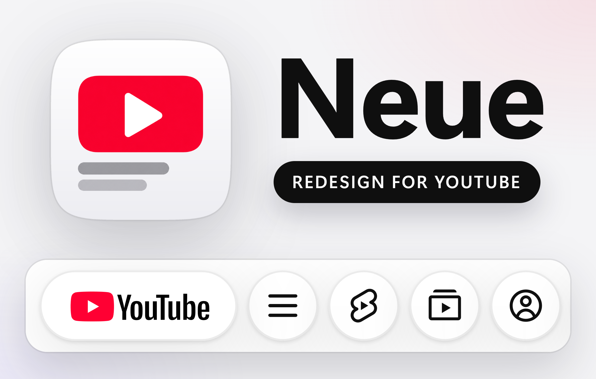
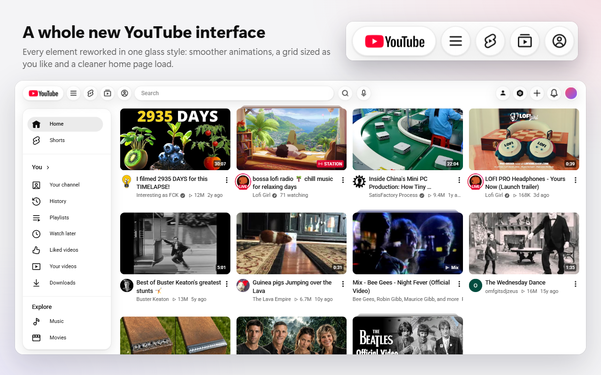
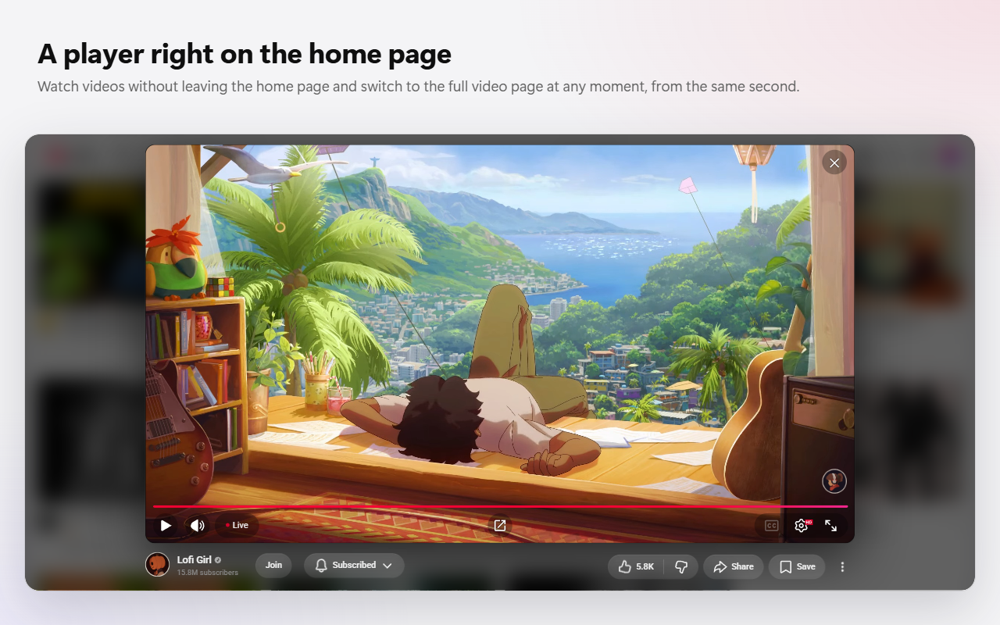
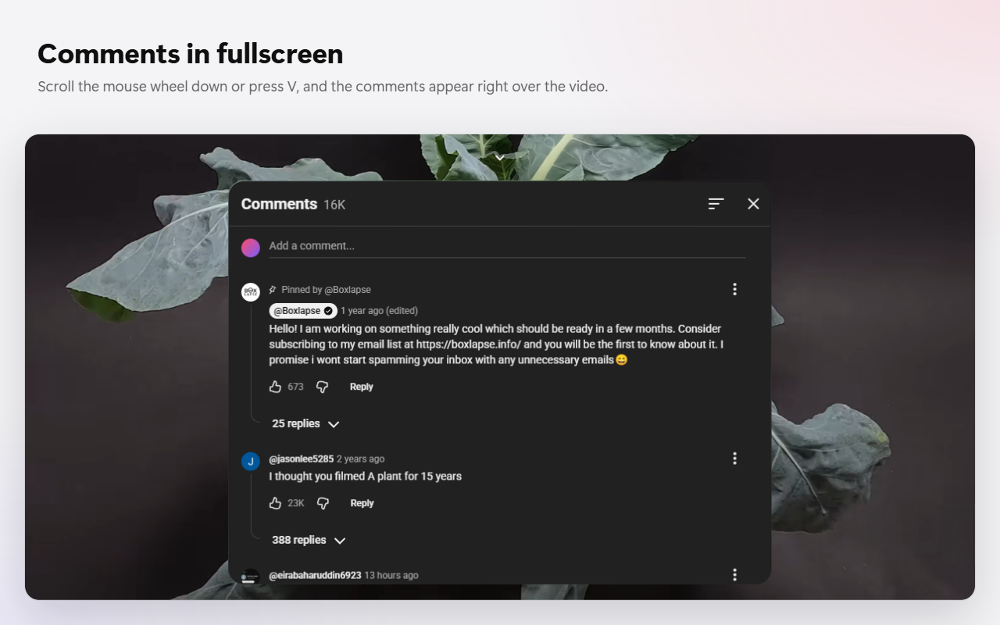
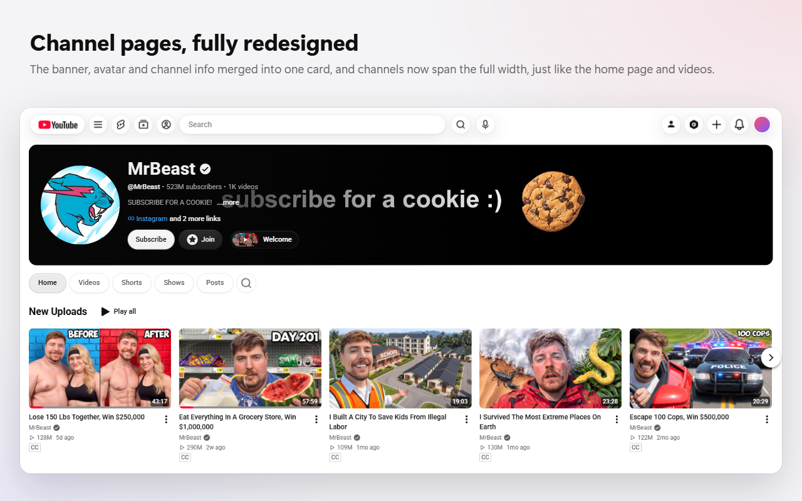
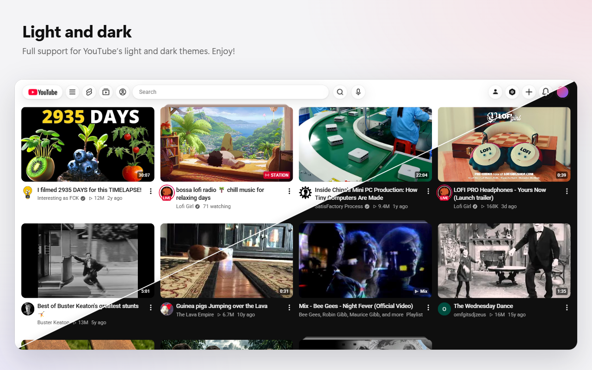

  

  <b>A whole new YouTube interface, in one glass style.</b> 
  A Chrome extension: free, no ads, no analytics, no servers.

  <a href="https://chromewebstore.google.com/detail/pbhodocjfoobobjkkenimpibhbedjkpb"><b>Install from the Chrome Web Store</b></a>
  &nbsp;·&nbsp;
  <a href="README.ru.md">Русская версия</a>

---

Neue changes how YouTube looks and works on the desktop site: a floating glass header, a video grid with as many videos per row as you like, videos that open in a pop-up player over the page, comments over a fullscreen video, and channel pages that use the whole window. Everything else stays YouTube: your account, subscriptions, recommendations and history work as before.

Settings are in Chrome's side panel, next to YouTube, and apply at once in every open tab.

## Contents

- [Header](#header)
- [☰ menu](#menu)
- [Home page](#home-page)
- [Pop-up player](#pop-up-player)
- [Video page](#video-page)
- [Fullscreen](#fullscreen)
- [Channels](#channels)
- [Playlists, history and search](#playlists-history-and-search)
- [Theme and glass](#theme-and-glass)
- [Settings](#settings)
- [Hotkeys](#hotkeys)
- [Languages](#languages)
- [Privacy](#privacy)
- [Requirements](#requirements)
- [Feedback](#feedback)

## Header

- **Floating glass buttons.** The flat top bar becomes a row of glass buttons and pills that line up with the edges of the video grid.
- **The logo** is a glass pill of the same height as the buttons.
- **Shorts, Subscriptions and You** move from the left column to the header, next to ☰.
- **Their menus** open on hover as a glass card right under the button, with rounded items.
- **"My channel" and "Studio"** become buttons before "Create" instead of hiding in the account menu.
- **Search bar width** is yours to choose: 320 to 1400 px. In a narrow window it gets shorter and never runs into the buttons.
- **One style for every button:** the same size, the same glass, the same shadow. The microphone loses its grey disc.
- **Icons are there at once.** YouTube loads its header icons a few seconds after the page appears; Neue draws them itself, so they are in place from the first frame.
- **Tooltips** are small glass captions under the button: after a short delay, and instantly when you move from one button to the next. Where names are already visible (the menus), there are none.
- **Narrow windows:** the header gives way in steps — first "My channel" and "Studio" hide, then Shorts, Subscriptions and You, and the search bar shrinks.

## ☰ menu

- **A floating glass card** at the level of the first row of videos, aligned with the left part of the header, instead of a sidebar glued to the window's edge.
- **Docked**, the card pushes the page to the right and covers nothing.
- **Menu items** are pills with even gaps; the current, hovered, pressed and focused item all keep the same shape.

## Home page

- **Videos per row: 1 to 12**, applied at once, without reloading. The number is a maximum: a narrow window shows fewer, so the cards don't get too small.
- **The topic bar** ("All", "Music", "Gaming"…) is hidden. Turned back on, it becomes glass pills that scroll away with the page.
- **Shorts shelves** can be hidden with one switch — on the home page, in search and in recommendations.
- **The topics shelf** (a shelf of topic buttons with a few videos) can be hidden too, whatever YouTube's language.
- **A calm splash screen** with the logo covers the page while YouTube rebuilds it on a full load, instead of the page jumping into place. It can be turned off.

## Pop-up player

- **A click on a video** on the home page or a channel page opens it in a pop-up player over the page. The page stays where it was.
- **The player takes the video's shape** from the start: wide, vertical or square, no jump from 16:9.
- **Under the video:** the channel, Subscribe, like, share, save and ⋯ — YouTube's own buttons, working with your account.
- **↗ opens the video's page** from the same second, in one movement: the picture moves into the page's player, sound and picture stay together. Middle click or Ctrl+click on ↗ opens it in a new tab; on a video card they work as usual on YouTube.
- **↗ and ×** look and hide like the player's own round buttons.
- **Save (E):** the playlist card opens in the corner of the player, and the "Saved" notice appears there too.
- **F** puts the pop-up player in full screen — the same player, only bigger.
- **History:** videos watched in the player count in your YouTube history, and the card on the page gets the red bar of what you watched.
- **Mixes and playlists** open in the player too; ↗ takes you to the mix with its queue.
- **Closing:** ×, Esc, or a click outside the video (that last one can be turned off).

## Video page

- **The same margins as the home page and channels**, instead of the page running almost to the screen's edges.
- **Live chat** sits exactly in the recommendations column and follows window and theater-mode changes.
- **Save (E)** works here too: the playlist card opens in the corner of the player, without darkening the page.
- **Comment sorting** opens a single clean menu: "Top" and "Newest".

## Fullscreen

- **Comments instead of recommendations.** In fullscreen, scrolling down raises a card of comments over the video instead of YouTube's grid of recommendations. V or the ⌃ button do the same.
- **The card** is glass, centred, with the comment box at the top; the list scrolls inside it.
- **The wheel** scrolls the comments from anywhere on the screen; scrolling up at the top of the list (a new gesture) closes the card.
- **Reply without leaving the video:** clicks in the comments don't pause it, and typing doesn't trigger the player's keys (k, f, m…).
- **Card size** is adjustable: width 700–1800 px, height 40–90% of the screen.
- At the end of a video, YouTube's end screen with recommendations stays as it is.

## Channels

- **The whole window width:** banner, header, tabs and videos run to the edges of the grid, on one line with the logo.
- **Channel info on the banner:** avatar, name, description and buttons sit on the banner's lower left over a dark gradient; the rest of the banner stays clear.
- **Tabs** are glass pills; search is a round button that opens into a field.
- **Shelves** show exactly 6 videos, and the arrows page by exactly 6; posts by 3; playlists in 6 columns.
- **"Welcome" button:** the trailer that YouTube autoplays on the channel page (muted, with captions) is removed from the page and opens from a button next to Subscribe — in the pop-up player, with sound.
- **Channel videos** open in the pop-up player, one after another, without leaving the channel.

## Playlists, history and search

- **Playlists, Watch later and Liked videos:** the playlist card starts at the page's edge next to the ☰ card instead of being pinned to the window's edge; cards and list start at the level of the first row.
- **History** starts at the page's edge, with search and actions on the right, under the avatar.
- **Search results** and filters start from the left edge of the search bar.

## Theme and glass

- **Light and dark:** Neue follows YouTube's theme, the settings panel included. What sits over video — the pop-up player, the comments card, a channel header on its banner — stays dark.
- **Glass:** opacity (30–95%) and blur (0–40 px) are set once for the whole interface.

## Settings

The extension's button opens the settings in Chrome's side panel, next to YouTube: one page per section, with icon tabs. Changes apply at once in all open YouTube tabs and sync through your Chrome account.

| Section | Setting | Values | Default |
|---|---|---|---|
| **Home** | Videos per row | 1–12 | 4 |
| | Pop-up player | on / off | on |
| | Close by clicking outside | on / off | on |
| | Topic bar | on / off | off |
| | Hide Shorts | on / off | off |
| | Hide the topics shelf | on / off | off |
| **Header** | Shorts, Subscriptions, You | on / off | on |
| | My channel and Studio | on / off | on |
| | Search bar width | 320–1400 px | 640 px |
| **Fullscreen** | Comments over the video | on / off | on |
| | Card width | 700–1800 px | 1200 px |
| | Height | 40–90% | 70% |
| **Channels** | "Welcome" button | on / off | on |
| **Appearance** | Glass opacity | 30–95% | 60% |
| | Blur under the glass | 0–40 px | 20 px |
| | Splash screen on load | on / off | on |

The **More** page has the hotkeys, export of all settings to a JSON file, import from a file and "Reset all".

## Hotkeys

| Key | Action |
|---|---|
| <kbd>V</kbd> | Open or close the comments in fullscreen |
| Wheel ↓ | Open the comments in fullscreen |
| <kbd>E</kbd> | Save to a playlist (pop-up player and the video's page) |
| <kbd>F</kbd> | Pop-up player in full screen |
| <kbd>Esc</kbd> | Close the pop-up player |

## Languages

The interface follows YouTube's language, not the browser's: English, Spanish, Portuguese, German, French, Italian, Russian, Polish, Turkish, Ukrainian, Japanese, Korean, Chinese (Simplified and Traditional), Indonesian, Vietnamese and Hindi.

## Privacy

Neue collects nothing and sends nothing to anyone. It has no servers, analytics or ads, runs only on www.youtube.com and talks only to YouTube itself. Settings are stored in Chrome. Details: [privacy policy](privacy-policy.md).

## Requirements

- Chrome 125 or later on a computer, the desktop site www.youtube.com.
- Does not change m.youtube.com, YouTube Music or YouTube players embedded in other sites.

## Feedback

Found a bug, have an idea, want a setting? Write — all of it is read.

- [GitHub Issues](https://github.com/codeislav/neue/issues)
- [Discord](https://discord.gg/7kBZKnp9DJ)
- E-mail: codeislav@gmail.com

---

Neue is an independent project and is not affiliated with or endorsed by YouTube or Google. YouTube is a trademark of Google LLC.
