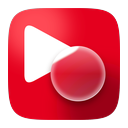
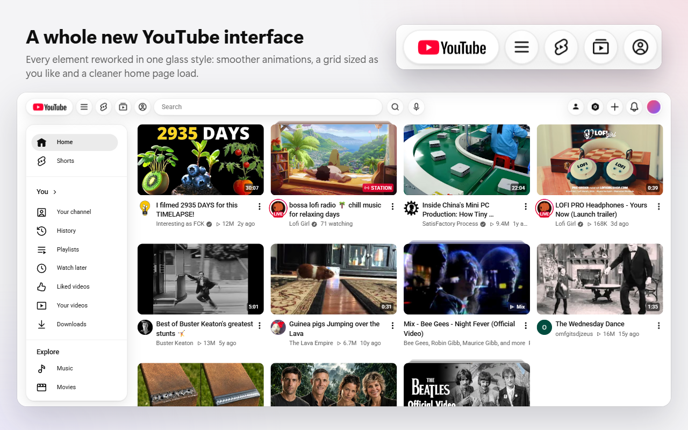
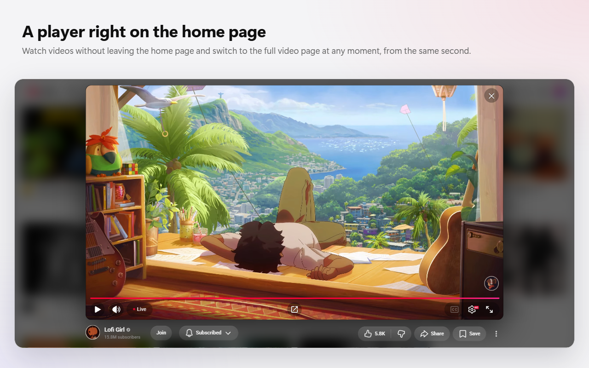
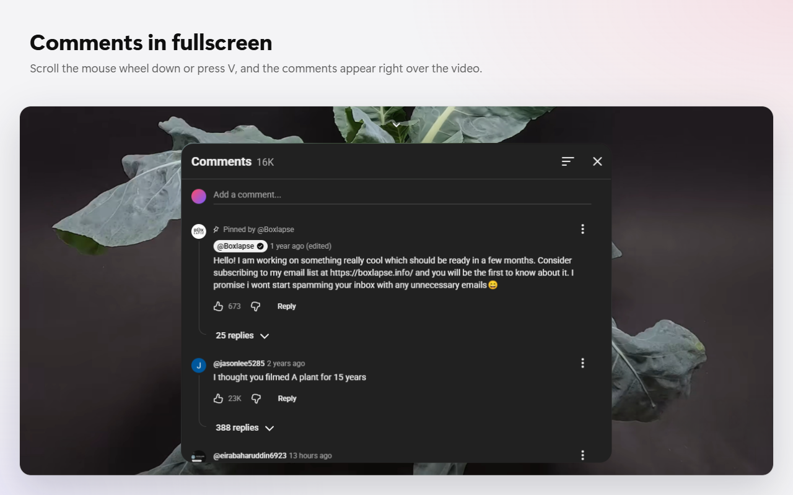
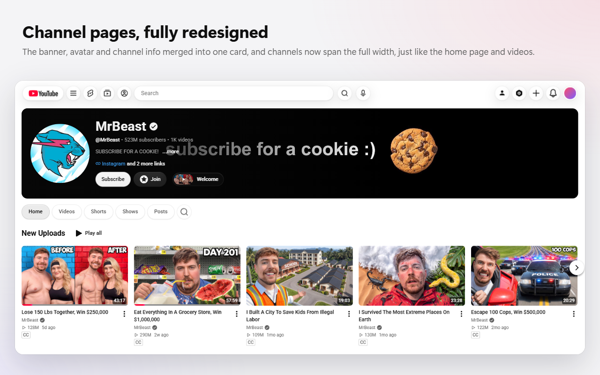
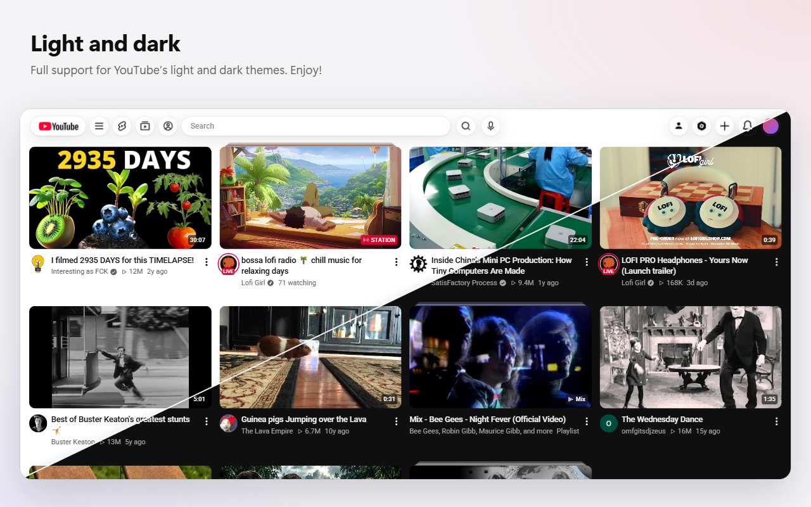

  

  <b>Новый интерфейс YouTube в одном стеклянном стиле.</b> 
  Расширение для Chrome: бесплатно, без рекламы, аналитики и серверов.

**[Установить из Chrome Web Store](https://chromewebstore.google.com/detail/pbhodocjfoobobjkkenimpibhbedjkpb)** · [English](README.md)

---

Neue меняет внешний вид и поведение YouTube. Шапка становится парящей и стеклянной, а в сетке столько видео в ряду, сколько вы выберете. Видео открываются во всплывающем плеере поверх страницы, с главами, комментариями, рекомендациями и чатом трансляций, комментарии показываются поверх видео в полноэкранном режиме, страницы каналов занимают всё окно, а анимации исправлены: страницы появляются целиком, без серых заглушек. Остальное — тот же YouTube: аккаунт, подписки, рекомендации и история работают как раньше.

Настройки — в боковой панели Chrome рядом с YouTube. Изменения применяются сразу во всех открытых вкладках.

## Что нового в 1.3.3

### 1.3.3: всплывающий плеер и карточки видео

- **Shorts больше не забивают рекомендации всплывающего плеера:** там они скрыты всегда, независимо от настроек скрытия Shorts.
- **Длинное описание больше не обрезается без возможности развернуть его,** в попапе и на весь экран. Кнопка «Показать текст видео» в описании открывает «Хронологию», «Эпизоды» и «Расшифровку видео» YouTube сбоку от всплывающего плеера; поиск находит нужные слова, а клик по строке включает видео с этого момента.
- **Маленькие карточки видео больше не теряются под крупным текстом и аватарками:** названия, аватарки, меню и значки времени уменьшаются вместе с карточками, когда вы размещаете больше видео в ряду.
- **У Shorts больше не пропадают название и кнопки во всплывающем плеере** после изменений YouTube. Ролики с полки Shorts тоже открываются с ними, а лишние кнопки плеера больше не перекрывают управление Shorts.
- **Мини-плеер YouTube больше не играет поверх попапа:** он встаёт на паузу и скрывается, пока попап открыт, а после закрытия возвращается на своё место, на паузе.
- **F5 больше не уводит плеер Shorts с места на мгновение:** он остаётся там, где должен быть, а название и кнопки плавно проявляются по мере загрузки.
- **Старый значок расширения заменён:** у Neue новая иконка.

### 1.3.2: всплывающий плеер

- **Shorts во всплывающем плеере:** вертикально, с родными кнопками YouTube, названием и лентой времени. Колесо или ↑ ↓ листают только тот блок, откуда открыт ролик, без посторонних Shorts. Комментарии и другие ролики с этим треком открываются сбоку, плеер не двигается.
- **Страница Shorts работает как попап:** название на плеере, комментарии сбоку и плеер не сдвигают, следующий Shorts сразу, без прокрутки с замиранием посередине, при обновлении страницы ничего не прыгает.
- **Всплывающий плеер теперь и в поиске.**
- **Плеер возвращается вместе с вкладкой:** после обновления страницы или повторного открытия браузера то же видео с той же секунды.
- **Конечные заставки, кнопка «Скрыть», подсказки и автовоспроизведение:** следующее видео открывается прямо в плеере.
- **Комментарии и описание — две вкладки одной карточки,** в попапе и на весь экран. Клик мимо карточки закрывает её.
- **Карточка и чат трансляции растягиваются за края** мышью, как окна.
- **Открытие и закрытие плеера без ступенек:** размытие и видео движутся как одно целое. В замере плеер начинает двигаться в 2–5 раз быстрее после нажатия. Рекомендации выезжают легко.
- **Мелочи:** в чате значки появляются вместе с сообщениями, стримы больше не открываются квадратом на мгновение, закрытие стрима из полноэкранного режима без ломаной анимации, пауза кликом срабатывает с первого раза и в первые секунды видео.

### 1.3.1: переработка настроек

- **Настройки разложены заново:** на «Главной» всё про ленту и плеер, трейлер канала в «Оформлении», отдельной вкладки «Каналы» больше нет.
- **Скрытие Playables:** полки и карточки с играми.
- **Скрытие Shorts теперь с выбором, где скрывать:** на главной и в подписках, в поиске, в рекомендациях, на страницах каналов.
- **Кнопки в шапке выключаются по одной:** Shorts, «Подписки», «Вы», «Посмотреть канал», «Творческая студия YouTube».
- **Больше никакого кружка под пустыми местами:** пока лента догружается, в центре новой партии стоит маленький логотип Neue.
- **Меню аккаунта в стекле Neue** вместе со всеми подменю. Оно больше не перескакивает вбок, а длинные списки прокручиваются внутри него. Открытое меню закрывается, когда клик по видео открывает всплывающий плеер.
- **Всплывающий плеер:** просмотры и дата под названием. Панель снизу и название появляются разом, название больше не ссылка.
- **Кнопки под видео держатся в одну строку дольше:** сначала «Поделиться» теряет подпись.
- **Меню ☰ на странице видео** лежит ровно на плеере, без зазоров.
- **Двойной клик по бегунку полосы прокрутки** возвращает наверх. Бегунок нажимается на всю ширину полосы, до края окна.
- **Значки ⋮ и лайк** больше не отключаются навсегда из-за одной необычной формы в профиле.
- **Ветка комментария теперь одна линия:** прямая и кривая одной толщины. Кнопка «N ответов» стоит там, где откроется первый ответ, поэтому при раскрытии ничего не прыгает.
- **Во всплывающем плеере ответы открываются за 0,7 секунды вместо 3,5:** все аватары и сердечки автора появляются вместе, блок сразу в своём размере. Карточка комментариев поднимается сразу полной высоты, а не вырастает, когда они пришли.

### 1.3

- **Чат трансляций во всплывающем плеере:** рядом с видео, а на весь экран — поверх него, полупрозрачным окном, которое можно перетащить куда угодно. Плотность и размер — в настройках. Открывается и закрывается клавишей C.
- **Рекомендации рядом со всплывающим плеером:** колонкой вровень с видео, и на трансляциях тоже. Клавиша R. На весь экран колонка скрыта, пока вы её не вызовете.
- **Окно поверх всего:** клавиша P переносит видео в маленькое окно поверх других вкладок и программ и обратно.
- **Кнопка скриншота** в плеере, во всплывающем и на странице видео: кадр в PNG-файл и в буфер обмена.
- **Комментарии:** ветки не открываются пустыми, аватары не появляются на глазах, комментарии уже на месте, когда вы до них долистали. Ветки и прокрутка заметно плавнее, а у карточки комментариев тонкий скроллбар Neue.
- **Главная при обновлении появляется целиком:** шапка, меню, панель тем, карточки и Shorts в один момент. Значки больше не догружаются на глазах.
- **Первый экран открывается быстрее,** на главной и на странице видео: сначала то, что видно, потом запас ниже.
- **Сетка без пустых мест** при любом числе видео в ряду. Полки вроде «Срочных новостей» показывают столько карточек, сколько в ряду, и их можно скрыть.
- **Панель тем** переключается без серых заглушек; **меню ☰** появляется целиком, с тонким скроллбаром.
- **На весь экран** «Поделиться» открывается прямо поверх видео, а выход из полноэкранного режима больше не подвешивает вкладку.
- **Заставка** включена по умолчанию, только на главной.
- **Мелочи:** меню ⋮ появляются целиком, крестик в поиске всегда стоит последним, а плашка плейлиста о скрытых недоступных видео — рядом с сортировкой.

### 1.2.1

- **Ветки комментариев раскрываются и сворачиваются плавно.** При первом раскрытии строка «N ответов» ждёт, пока ответы загрузятся, — без кружка загрузки и пустого места, потом ответы раскрываются целиком вместе с линией ветки. Клик по линии плавно сворачивает их обратно. Линии ветки свои. Исправлено: ответы иногда показывались дважды.
- **Новая линия загрузки вверху:** плавная, не замирает и доходит до конца ровно тогда, когда страница показана — и при обновлении главной по логотипу тоже.
- **Отступы от края экрана** («Оформление»): от 24 до 240 px на всех страницах.
- **Свой тонкий скроллбар** поверх страницы: системный больше не отнимает ширину, и страница не сдвигается, когда он появляется или пропадает.
- **Страница видео при прямом заходе** (обновление, ссылка): плеер с первого кадра в форме ролика (21:9, 4:3, вертикальные) и на своём месте, в режиме кинотеатра тоже.
- **Главная со страницы видео** больше не показывает на миг старую ленту перед новой.
- **Поиск:** значки, ⋮ и галочки с первого кадра; поиск по сайту приходит целиком.
- **Трансляции:** чат записи появляется сразу. В полноэкранном режиме кнопка «Чат» открывает чат рядом с видео — уже прежнего и по высоте видео.

### 1.2

- **Страницы появляются целиком и сразу:** главная, каналы, страница видео, поиск, «История», плейлисты и «Вы» — шапка, карточки, картинки и значки в одном кадре, без серых заглушек.
- **Заставка при загрузке по умолчанию выключена:** страницы и так появляются целиком. Её можно включить («Оформление» → «Загрузка»); с ней ролик на странице видео начинается вместе со страницей.
- **Из всплывающего плеера на страницу видео — плавный переезд без паузы:** видео продолжается с того же мгновения, звук не повторяется и не щёлкает.
- **Кинотеатр** без двоящейся колонки и серой полосы вокруг плеера.
- **Лента и комментарии прокручиваются плавнее:** следующие ролики подгружаются заранее.
- **Результаты поиска** сразу на своём месте; обновление главной по логотипу — без пустого экрана.
- **Новые страницы плейлистов YouTube** выглядят как надо; кнопка сортировки в «Смотреть позже» не просвечивает.

### 1.1

- **Главы во всплывающем плеере:** на шкале времени, как на странице видео. Название главы рядом со временем открывает список глав над шкалой, которая остаётся на виду: текущая глава отмечена, клик переходит к главе, любой можно поделиться.
- **Комментарии во всплывающем плеере:** колесо вниз или V поднимает карточку комментариев поверх видео, как в полноэкранном режиме. Время в комментарии перематывает видео на этот момент.
- **Во вкладке — название видео,** пока его показывает всплывающий плеер, как на странице видео.
- **Широкие видео** (21:9 и шире) сразу открываются в своей форме, как уже открывались узкие.
- **«Скрывать Shorts»** убирает Shorts и из полки «Для вас» на канале, а вкладка Shorts канала и фильтр «Shorts» в поиске по-прежнему их показывают.
- **«Поделиться»** во всплывающем плеере тёмное в обеих темах; у главы оно открывается прямо в карточке.

## Содержание

- [Что нового в 1.3.3](#whats-new)
- [Исправленные анимации YouTube](#smooth)
- [Шапка](#header)
- [Меню ☰](#menu)
- [Главная](#home)
- [Всплывающий плеер](#player)
- [Страница видео](#watch)
- [Полноэкранный режим](#fullscreen)
- [Каналы](#channels)
- [Плейлисты, история и поиск](#pages)
- [Тема и стекло](#theme)
- [Настройки](#settings)
- [Горячие клавиши](#hotkeys)
- [Языки](#languages)
- [Конфиденциальность](#privacy)
- [Требования](#requirements)
- [Обратная связь](#feedback)

## Исправленные анимации YouTube

- **Страницы появляются целиком.** YouTube показывает страницу по кускам: серые заглушки, потом текст, потом по одной картинки и значки. Neue ждёт, пока то, что на экране, будет готово, и показывает его сразу — главную, каналы, страницу видео, поиск, «Историю», плейлисты и «Вы».
- **Ничего не прыгает.** Плеер с первого кадра в форме ролика и на своём месте — и при обновлении страницы, и в кинотеатре; шапка на месте с первого кадра; шапка канала, вкладки и результаты поиска стоят на месте.
- **Внутри сайта:** описание и рекомендации видео появляются вместе, а не по ступенькам; ролик другой формы не сдвигает страницу; старая лента не показывается перед новой.
- **Всплывающий плеер** открывается и закрывается без ступенек: размытие и видео движутся как одно целое.
- **Из всплывающего плеера на страницу видео** — одним переездом, с того же кадра, без повтора звука.
- **Страница Shorts** работает как попап: название на плеере, комментарии сбоку и плеер не сдвигают, следующий Shorts сразу, при обновлении ничего не прыгает.
- **Ветки комментариев** раскрываются и сворачиваются плавно, с одной ровной линией, а строка «N ответов» при этом не сдвигается.
- **Пока лента догружается,** в центре новой партии стоит маленький логотип Neue, а не кружок под пустыми местами.
- **Линия загрузки** вверху идёт плавно и заканчивается, когда страница показана.
- **Сначала то, что видно:** первый экран открывается раньше, чем начинает грузиться то, что ниже. Потом следующие видео, комментарии и картинки подгружаются заранее, а свой тонкий скроллбар не сдвигает страницу вбок. Двойной клик по его бегунку возвращает наверх.

## Шапка

- **Парящие стеклянные кнопки.** Вместо плоской полосы — ряд стеклянных кнопок и пилюль. Края шапки совпадают с краями сетки видео.
- **Логотип** — стеклянная пилюля той же высоты, что и кнопки.
- **Shorts, «Подписки» и «Вы»** переехали из левой колонки в шапку, рядом с ☰. Каждую кнопку можно выключить.
- **Их меню** открываются по наведению стеклянной карточкой прямо под кнопкой, пункты скруглены.
- **«Мой канал» и «Студия»** — кнопки перед «Создать», а не пункты в меню аккаунта. Каждую можно выключить.
- **Меню аккаунта** в том же стекле, вместе со всеми подменю. Оно открывается под своей кнопкой и остаётся там, а длинные списки прокручиваются внутри него.
- **Длина поиска** — какую выберете: от 320 до 1400 px. В узком окне строка укорачивается и не наезжает на кнопки.
- **Один стиль для всех кнопок:** одинаковые размер, стекло и тень. У микрофона больше нет серого кружка.
- **Значки на месте сразу.** YouTube догружает значки шапки через несколько секунд после показа страницы. Neue рисует их сам, поэтому они видны с первого кадра.
- **Подсказки** — маленькие стеклянные подписи под кнопкой. Появляются с небольшой задержкой, а при переходе с кнопки на кнопку — сразу. Там, где названия и так видны (в меню), подсказок нет.
- **Узкое окно:** шапка уступает место по шагам. Сначала прячутся «Мой канал» и «Студия», потом Shorts, «Подписки» и «Вы», а поиск укорачивается.

## Меню ☰

- **Парящая стеклянная карточка** на уровне первого ряда видео вместо сайдбара, приклеенного к краю окна. Она выровнена по левой части шапки.
- **Закреплённая** карточка сдвигает страницу вправо и ничего не перекрывает.
- **Пункты меню** — пилюли с ровными промежутками. Текущий, наведённый, нажатый пункт и пункт в фокусе одной формы.
- **Появляется целиком** при обновлении страницы, со значками с первого кадра и тонким скроллбаром.
- **На странице видео** лежит ровно на плеере, без зазоров.

## Главная

- **Видео в ряду: от 1 до 12.** Меняется сразу, без перезагрузки. Это максимум: в узком окне видео меньше, чтобы карточки не мельчали.
- **Панель тем** («Все», «Музыка», «Игры»…) скрыта. Если её включить, она станет стеклянными пилюлями и будет уезжать вместе со страницей.
- **Shorts** можно скрыть и выбрать где: на главной и в подписках, в поиске, в рекомендациях, на страницах каналов. Там, где вы сами пришли за Shorts, они остаются: на вкладке Shorts канала и в фильтре «Shorts» в поиске.
- **Playables** (полки и карточки с играми) тоже можно скрыть.
- **Подборка «Ещё темы»** тоже убирается, на любом языке YouTube.
- **Полки новостей** вроде «Срочных новостей» показывают столько карточек, сколько в ряду, и их тоже можно скрыть.
- **Спокойная заставка** с логотипом закрывает главную, пока она загружается. С 1.3 включена по умолчанию, только на главной; её можно выключить («Главная» → «Загрузка»).

## Всплывающий плеер

- **Клик по видео** на главной, на странице канала или в поиске открывает его во всплывающем плеере поверх страницы. Страница остаётся на месте.
- **Shorts** открываются в нём же, вертикально, с родными кнопками YouTube. Колесо или ↑ ↓ листают только тот блок, откуда открыт ролик; комментарии и другие ролики с этим треком открываются сбоку от плеера.
- **Плеер возвращается вместе с вкладкой:** после обновления страницы или повторного открытия браузера то же видео с той же секунды.
- **Конечные заставки, подсказки и автовоспроизведение** работают как на странице видео: следующее видео открывается прямо в плеере.
- **Плеер сразу в форме видео:** 16:9, 21:9 и шире, 4:3, квадратное или вертикальное — без прыжка из 16:9.
- **Главы** — на шкале времени, как на странице видео. Название главы рядом со временем открывает список глав над шкалой: текущая глава отмечена, клик переходит к главе, а «Поделиться» у главы открывается прямо в карточке.
- **Комментарии поверх видео:** колесо вниз или V поднимает их карточкой, как в полноэкранном режиме; колесо вверх в начале списка, V, Esc или клик мимо карточки опускают её. Время в комментарии перематывает видео на этот момент. Описание — вторая вкладка карточки, а саму карточку можно растянуть за края.
- **Рекомендации рядом с видео:** R или кнопка открывает рекомендации YouTube колонкой вровень с видео, и на трансляциях тоже. Если видео слишком широкое и места нет, плеер становится меньше. На весь экран колонка скрыта, пока вы её не вызовете.
- **Чат трансляции:** C или кнопка открывает чат рядом с видео. На весь экран это полупрозрачное окно, которое можно перетащить куда угодно; плотность и размер — в настройках.
- **Окно поверх всего:** P или кнопка переносит видео в маленькое окно поверх других вкладок и программ и обратно.
- **Скриншот:** кнопка в плеере сохраняет кадр в PNG-файл и копирует его в буфер обмена.
- **Название вкладки** — название видео, пока оно играет в плеере, и снова название страницы, когда плеер закрыт.
- **Просмотры и дата** под названием поверх плеера. Название и нижняя панель появляются разом, название больше не ссылка.
- **Под видео:** канал, «Подписаться», лайк, «Поделиться», «Сохранить» и ⋯. Это кнопки самого YouTube, они работают с вашим аккаунтом.
- **↗ открывает страницу видео** с той же секунды, одним движением. Картинка переезжает в плеер страницы, звук и картинка не расходятся. Средняя кнопка мыши или Ctrl+клик по ↗ открывают страницу в новой вкладке. По карточке видео они работают как обычно на YouTube.
- **↗ и ×** выглядят и прячутся как родные круглые кнопки плеера.
- **«Сохранить» (E):** карточка выбора плейлиста открывается в углу плеера, туда же приходит уведомление «Сохранено».
- **F** — всплывающий плеер на весь экран: тот же плеер, только больше.
- **История:** просмотры в плеере засчитываются в историю YouTube, на карточке появляется красная полоса просмотренного.
- **Миксы и плейлисты** тоже открываются в плеере. ↗ ведёт в микс с его очередью.
- **Закрыть:** ×, Esc или клик мимо видео (клик мимо можно отключить).

## Страница видео

- **Те же поля, что на главной и на каналах.** Страница больше не тянется почти до краёв экрана (отступ задаётся в «Оформлении»: 24–240 px от края экрана).
- **Плеер** с первого кадра в форме ролика и на своём месте, даже при обновлении страницы.
- **Живой чат** стоит ровно в колонке рекомендаций и подстраивается под размер окна и режим «Кинотеатр»; чат записи трансляции появляется сразу.
- **Ветки комментариев** раскрываются и сворачиваются плавно: ответы выходят целиком вместе с линией ветки, а клик по линии сворачивает их обратно.
- **«Сохранить» (E)** работает и здесь: карточка плейлиста открывается в углу плеера, страница не затемняется.
- **Скриншот:** кнопка в плеере сохраняет кадр в PNG-файл и копирует его в буфер обмена.
- **Сортировка комментариев** — одно аккуратное меню: «Популярные» и «Новые».
- **Кнопки под видео** дольше держатся в одну строку с каналом: если их слишком много, сначала «Поделиться» теряет подпись.

## Полноэкранный режим

- **Комментарии вместо рекомендаций.** В полноэкранном режиме колесо вниз поднимает поверх видео карточку с комментариями, а не сетку рекомендаций YouTube. То же делают V и кнопка ⌃.
- **Карточка** стеклянная, по центру. Поле для комментария — сверху, список листается внутри.
- **Колесо** листает комментарии откуда угодно на экране. Новый жест вверх в начале списка закрывает карточку.
- **Ответить, не выходя из видео:** клики по комментариям не ставят паузу, а набор текста не задевает клавиши плеера (k, f, m…).
- **Размер карточки** настраивается: ширина 700–1800 px, высота 40–90 % экрана.
- В конце видео заставка YouTube с рекомендациями остаётся как есть.
- **«Поделиться»** открывается прямо поверх видео, целиком.
- **Трансляции:** кнопка «Чат» открывает чат рядом с видео, по его высоте.

## Каналы

- **Во всю ширину окна:** баннер, шапка, вкладки и видео идут до краёв сетки, на одной линии с логотипом.
- **Данные канала на баннере:** аватар, имя, описание и кнопки — слева внизу баннера, над тёмным градиентом. Остальная часть баннера чистая.
- **Вкладки** — стеклянные пилюли. Поиск — круглая кнопка, раскрывается в поле.
- **Полки:** ровно по 6 видео, стрелки листают ровно по 6; записи — по 3, плейлисты — в 6 колонок.
- **Кнопка «Приветствие».** Трейлер, который YouTube сам запускает на странице канала без звука и с субтитрами, убран со страницы. Он открывается по кнопке рядом с «Подписаться» — во всплывающем плеере, со звуком.
- **Видео канала** открываются во всплывающем плеере одно за другим, не уходя со страницы канала.

## Плейлисты, история и поиск

- **Плейлисты, «Смотреть позже» и «Понравившиеся».** Карточка плейлиста начинается от края страницы рядом с карточкой ☰, а не прибита к краю окна. Карточки и список начинаются на уровне первого ряда.
- **История** начинается от края страницы, а поиск и действия стоят справа, под аватаром.
- **Результаты поиска** и фильтры начинаются от левого края строки поиска.

## Тема и стекло

- **Светлая и тёмная тема:** Neue следует теме YouTube, включая панель настроек. Всё, что над видео — всплывающий плеер, карточка комментариев, шапка канала на баннере, — остаётся тёмным.
- **Стекло:** плотность (30–95 %) и размытие (0–40 px) задаются один раз для всего интерфейса.
- **Отступы:** расстояние от края экрана до содержимого, 24–240 px, на всех страницах; шапка следует за ним.

## Настройки

Кнопка расширения открывает настройки в боковой панели Chrome рядом с YouTube. Каждый раздел — отдельная страница со своей вкладкой-значком. Изменения применяются сразу во всех открытых вкладках YouTube и синхронизируются через аккаунт Chrome.

| Раздел | Настройка | Значения | По умолчанию |
|---|---|---|---|
| **Главная** | Видео в ряду | 1–12 | 4 |
| | Панель тем | вкл. / выкл. | выкл. |
| | Скрывать Shorts | вкл. / выкл. | выкл. |
| | — На главной и в подписках | вкл. / выкл. | вкл. |
| | — В поиске | вкл. / выкл. | вкл. |
| | — В рекомендациях | вкл. / выкл. | вкл. |
| | — На страницах каналов | вкл. / выкл. | вкл. |
| | Скрывать Playables | вкл. / выкл. | выкл. |
| | Скрывать «Ещё темы» | вкл. / выкл. | выкл. |
| | Скрывать новости | вкл. / выкл. | выкл. |
| | Всплывающий плеер | вкл. / выкл. | вкл. |
| | Закрывать кликом мимо | вкл. / выкл. | вкл. |
| | Рекомендации рядом с плеером | вкл. / выкл. | вкл. |
| | Чат стримов | вкл. / выкл. | вкл. |
| | Плотность фона чата | 0–100 % | 60 % |
| | Ширина чата | 240–700 px | 340 px |
| | Высота чата | 30–100 % | 85 % |
| | Заставка при загрузке | вкл. / выкл. | вкл. |
| **Шапка** | Shorts | вкл. / выкл. | вкл. |
| | Подписки | вкл. / выкл. | вкл. |
| | Вы | вкл. / выкл. | вкл. |
| | Посмотреть канал | вкл. / выкл. | вкл. |
| | Творческая студия YouTube | вкл. / выкл. | вкл. |
| | Длина поиска | 320–1400 px | 640 px |
| **Полноэкранный режим** | Комментарии поверх видео | вкл. / выкл. | вкл. |
| | Ширина карточки | 700–1800 px | 1200 px |
| | Высота | 40–90 % | 70 % |
| **Оформление** | Отступы от края экрана | 24–240 px | 66 px |
| | Плотность стекла | 30–95 % | 60 % |
| | Размытие под стеклом | 0–40 px | 20 px |
| | Кнопка «Приветствие» | вкл. / выкл. | вкл. |

На странице **«Ещё»** — горячие клавиши, экспорт всех настроек в JSON-файл, импорт из файла и «Сбросить всё».

## Горячие клавиши

| Клавиша | Действие |
|---|---|
| <kbd>V</kbd> | Открыть или закрыть комментарии (полноэкранный режим и всплывающий плеер) |
| Колесо ↓ | Открыть комментарии (полноэкранный режим и всплывающий плеер) |
| <kbd>E</kbd> | Сохранить в плейлист (всплывающий плеер и страница видео) |
| <kbd>F</kbd> | Всплывающий плеер на весь экран |
| <kbd>R</kbd> | Рекомендации рядом со всплывающим плеером |
| <kbd>C</kbd> | Чат трансляции во всплывающем плеере |
| <kbd>P</kbd> | Всплывающий плеер: окно поверх всех вкладок и программ |
| <kbd>↑</kbd> <kbd>↓</kbd> | Предыдущий и следующий Shorts (всплывающий плеер и страница Shorts) |
| <kbd>Esc</kbd> | Закрыть всплывающий плеер |

## Языки

Язык интерфейса — как у YouTube, а не как у браузера: английский, испанский, португальский, немецкий, французский, итальянский, русский, польский, турецкий, украинский, японский, корейский, китайский (упрощённый и традиционный), индонезийский, вьетнамский и хинди.

## Конфиденциальность

Neue ничего не собирает и никому ничего не отправляет. У расширения нет серверов, аналитики и рекламы. Оно работает только на www.youtube.com и обращается только к самому YouTube. Настройки хранятся в Chrome. Подробно — в [политике конфиденциальности](privacy-policy.md#ru).

## Требования

- Chrome 125 или новее на компьютере, в том числе подключённом к телевизору; полная версия сайта www.youtube.com.
- Не меняет m.youtube.com, YouTube Music и плееры YouTube, встроенные в другие сайты.

## Обратная связь

Нашли ошибку, есть идея, не хватает настройки? Напишите — я читаю всё.

- [Issues на GitHub](https://github.com/codeislav/neue/issues)
- [Discord](https://discord.gg/7kBZKnp9DJ)
- Почта: codeislav@gmail.com

---

Neue — независимый проект, не связан с YouTube и Google и не одобрен ими. YouTube — товарный знак Google LLC.
